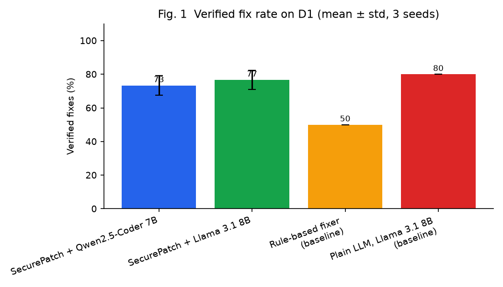
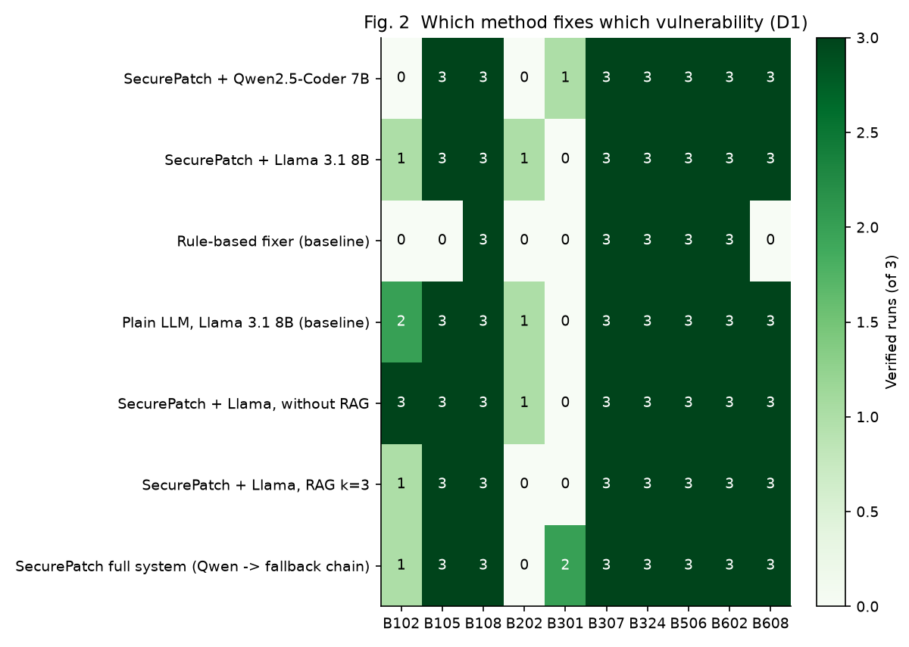
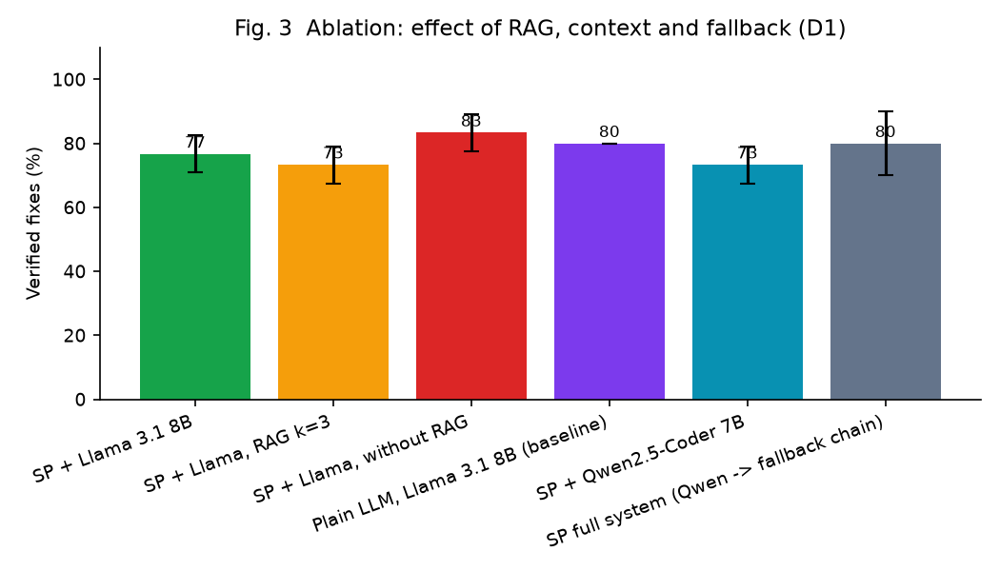
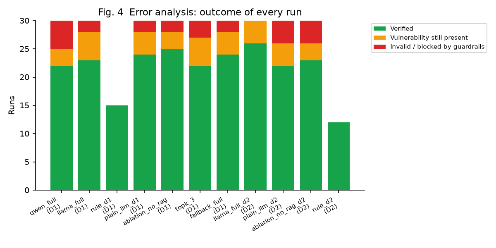
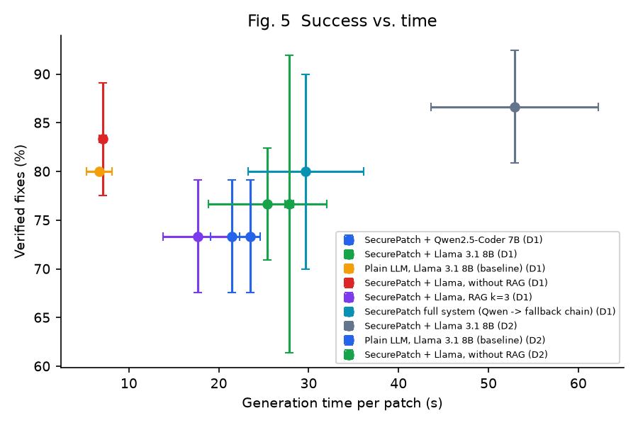
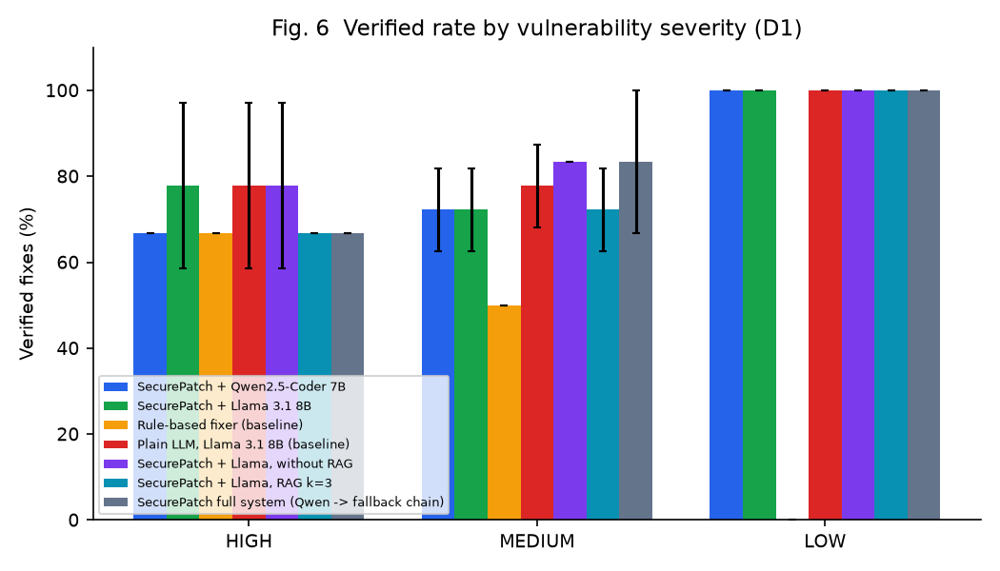
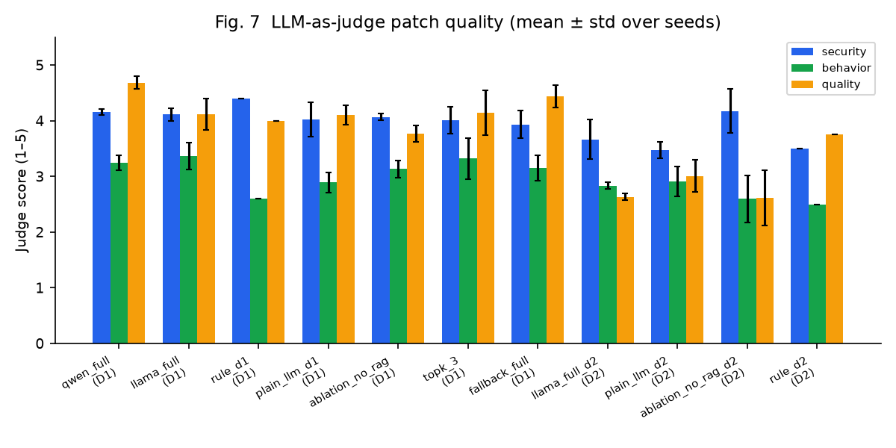
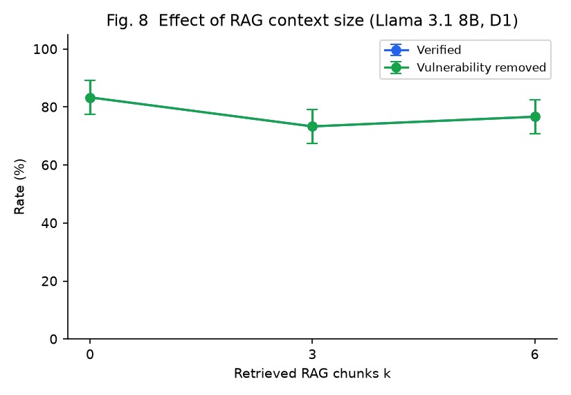

# SecurePatch experiment results (v2)

Generated from `workspace/experiments/v2`. Every rate is computed per seed (seeds [11, 22, 33]) over all vulnerabilities, then reported as **mean ± standard deviation** over the seeds. Best value per column in **bold**.

## Test environment

| Item | Value |
|---|---|
| CPU | AMD Ryzen 7 5800HS with Radeon Graphics |
| RAM | 15.4 GB |
| GPU | AMD Radeon(TM) Graphics; NVIDIA GeForce RTX 3050 Laptop GPU |
| OS | Windows-11-10.0.26300-SP0 |
| Python (backend) | 3.12.6 |
| Ollama | 0.40.17 |
| fastapi | 0.141.1 |
| bandit | 1.9.4 |
| chromadb | 1.5.9 |
| sentence-transformers | 6.1.0 |
| langchain-text-splitters | 1.1.3 |
| langchain-core | 1.6.6 |
| torch | 2.14.1 |
| pytest | 9.1.1 |
| requests | 2.34.2 |
| Semgrep | 1.186.0 (pinned in scripts/setup_semgrep.py) |
| Sandbox isolation | process |

## Models

| Key | Ollama model | Parameters | Quantization | Digest |
|---|---|---|---|---|
| qwen2.5-coder | qwen2.5-coder:7b | 7.6B | Q4_K_M | dae161e27b0e |
| llama3.1 | llama3.1:8b | 8.0B | Q4_K_M | 46e0c10c039e |
| codestral | codestral:22b-v0.1-q3_K_S | 22.2B | Q3_K_S | 435a805994fa |
| qwen2.5-1.5b | qwen2.5:1.5b | 1.5B | Q4_K_M | 65ec06548149 |
| phi3-mini | phi3:mini | 3.8B | Q4_0 | 4f2222927938 |

## Parameters

| Parameter | Value |
|---|---|
| Temperature (generation) | 0.2 |
| Random seeds | 11, 22, 33 |
| Runs per configuration | 3 (one per seed) |
| num_predict (max output tokens) | 600 |
| top_p | 0.9 |
| repeat_penalty (Llama / Qwen) | 1.1 / 1.15 |
| num_ctx (context window) | 8192 |
| Embedding model | sentence-transformers/all-MiniLM-L6-v2 |
| RAG chunk size / overlap (chars) | 6400 / 1200 |
| RAG top-k chunks | 6 |
| Max RAG context (chars) | 6000 |
| Fallback order | qwen2.5-coder → llama3.1 → qwen2.5-1.5b → phi3-mini |
| pytest timeout (s) | 180 |
| Judge model / temperature / seed | deepseek-coder-v2:16b-lite-instruct-q2_K / 0.0 / 7 |

## Datasets

- **D1: sample_repo (synthetic benchmark)**: 10 vulnerabilities (6 MEDIUM, 1 LOW, 3 HIGH). Written by the SecurePatch team; 10 planted vulnerabilities, 19 pytest regression tests. Rules: B102, B105, B108, B202, B301, B307, B324, B506, B602, B608.
- **D2: OWASP PyGoat (external)**: 10 vulnerabilities (3 HIGH, 7 MEDIUM). https://github.com/adeyosemanputra/pygoat (OWASP project) commit 2aa4cc14f251e4a780e94e200aed6b36a5b15c21 (2026-11-01); third-party code, no tests cover the vulnerable lab code. Rules: B602, B324, B324, B307, B506, B301, B301, B608, B113, B317.

## Metrics

| Metric | Why |
|---|---|
| Patch generated (%) | Share of runs that produced a usable function at all. |
| Valid syntax (%) | The patch parses as exactly one Python function. |
| Vulnerability removed (%) | The scanner no longer reports the targeted finding: the security goal. |
| Tests pass (%) | The project's existing tests still pass: behaviour is preserved. |
| Verified (%) | Main metric: vulnerability removed AND tests pass AND no guardrail violation. |
| Generation time (s) | Practicality on a laptop: wall-clock time to produce a patch. |
| Judge scores (1–5) | Patch quality beyond what the scanner can see (real fix, behaviour, minimality). |

## Results on D1 (sample_repo (synthetic benchmark))

| Method | Patch generated (%) | Valid syntax (%) | Vulnerability removed (%) | Tests pass (%) | Verified (%) | Gen. time (s) ↓ | Judge security (1–5) | Judge behaviour (1–5) | Judge quality (1–5) |
|---|---|---|---|---|---|---|---|---|---|
| SecurePatch + Qwen2.5-Coder 7B | 83.3 ± 5.8 | 83.3 ± 5.8 | 73.3 ± 5.8 | 83.3 ± 5.8 | 73.3 ± 5.8 | 21.4 ± 2.3 | 4.16 ± 0.06 | 3.25 ± 0.13 | **4.69 ± 0.11** |
| SecurePatch + Llama 3.1 8B | 93.3 ± 5.8 | 93.3 ± 5.8 | 76.7 ± 5.8 | **93.3 ± 5.8** | 76.7 ± 5.8 | 25.4 ± 6.6 | 4.11 ± 0.11 | **3.37 ± 0.24** | 4.12 ± 0.28 |
| Rule-based fixer (baseline) | 50.0 ± 0.0 | 50.0 ± 0.0 | 50.0 ± 0.0 | 50.0 ± 0.0 | 50.0 ± 0.0 | **0.0 ± 0.0** | **4.40 ± 0.00** | 2.60 ± 0.00 | 4.00 ± 0.00 |
| Plain LLM, Llama 3.1 8B (baseline) | **96.7 ± 5.8** | **96.7 ± 5.8** | **80.0 ± 0.0** | **93.3 ± 5.8** | **80.0 ± 0.0** | 6.7 ± 1.4 | 4.02 ± 0.31 | 2.89 ± 0.18 | 4.10 ± 0.17 |

## Results on D2 (OWASP PyGoat (external))

| Method | Patch generated (%) | Valid syntax (%) | Vulnerability removed (%) | Tests pass (%) | Verified (%) | Gen. time (s) ↓ | Judge security (1–5) | Judge behaviour (1–5) | Judge quality (1–5) |
|---|---|---|---|---|---|---|---|---|---|
| SecurePatch + Llama 3.1 8B | **100.0 ± 0.0** | **100.0 ± 0.0** | **86.7 ± 5.8** | **100.0 ± 0.0** | **86.7 ± 5.8** | 52.9 ± 9.3 | **3.67 ± 0.35** | 2.83 ± 0.06 | 2.63 ± 0.06 |
| Plain LLM, Llama 3.1 8B (baseline) | 93.3 ± 5.8 | 93.3 ± 5.8 | 73.3 ± 5.8 | 86.7 ± 5.8 | 73.3 ± 5.8 | 23.5 ± 1.2 | 3.47 ± 0.15 | **2.90 ± 0.27** | 3.01 ± 0.29 |
| Rule-based fixer (baseline) | 40.0 ± 0.0 | 40.0 ± 0.0 | 40.0 ± 0.0 | 40.0 ± 0.0 | 40.0 ± 0.0 | **0.0 ± 0.0** | 3.50 ± 0.00 | 2.50 ± 0.00 | **3.75 ± 0.00** |

## Ablation study (D1)

| Method | Patch generated (%) | Valid syntax (%) | Vulnerability removed (%) | Tests pass (%) | Verified (%) | Gen. time (s) ↓ | Judge security (1–5) | Judge behaviour (1–5) | Judge quality (1–5) |
|---|---|---|---|---|---|---|---|---|---|
| SecurePatch + Llama 3.1 8B | 93.3 ± 5.8 | 93.3 ± 5.8 | 76.7 ± 5.8 | **93.3 ± 5.8** | 76.7 ± 5.8 | 25.4 ± 6.6 | 4.11 ± 0.11 | **3.37 ± 0.24** | 4.12 ± 0.28 |
| SecurePatch + Llama, RAG k=3 | 90.0 ± 10.0 | 90.0 ± 10.0 | 73.3 ± 5.8 | 90.0 ± 10.0 | 73.3 ± 5.8 | 17.6 ± 3.8 | 4.01 ± 0.24 | 3.32 ± 0.36 | 4.14 ± 0.41 |
| SecurePatch + Llama, without RAG | **100.0 ± 0.0** | **100.0 ± 0.0** | **83.3 ± 5.8** | **93.3 ± 5.8** | **83.3 ± 5.8** | 7.1 ± 0.4 | 4.07 ± 0.06 | 3.13 ± 0.15 | 3.77 ± 0.15 |
| Plain LLM, Llama 3.1 8B (baseline) | 96.7 ± 5.8 | 96.7 ± 5.8 | 80.0 ± 0.0 | **93.3 ± 5.8** | 80.0 ± 0.0 | **6.7 ± 1.4** | 4.02 ± 0.31 | 2.89 ± 0.18 | 4.10 ± 0.17 |
| SecurePatch + Qwen2.5-Coder 7B | 83.3 ± 5.8 | 83.3 ± 5.8 | 73.3 ± 5.8 | 83.3 ± 5.8 | 73.3 ± 5.8 | 21.4 ± 2.3 | **4.16 ± 0.06** | 3.25 ± 0.13 | **4.69 ± 0.11** |
| SecurePatch full system (Qwen -> fallback chain) | 93.3 ± 5.8 | 93.3 ± 5.8 | 80.0 ± 10.0 | **93.3 ± 5.8** | 80.0 ± 10.0 | 29.7 ± 6.4 | 3.93 ± 0.25 | 3.15 ± 0.23 | 4.44 ± 0.21 |

- *without RAG*: retrieved repository context removed, everything else unchanged.
- *Plain LLM*: RAG, source graph, callers, tests and imports all removed (finding + function only).
- *full system*: Qwen first, automatic fallback to other models when generation fails.

## Ablation study (D2)

| Method | Patch generated (%) | Valid syntax (%) | Vulnerability removed (%) | Tests pass (%) | Verified (%) | Gen. time (s) ↓ | Judge security (1–5) | Judge behaviour (1–5) | Judge quality (1–5) |
|---|---|---|---|---|---|---|---|---|---|
| SecurePatch + Llama 3.1 8B | **100.0 ± 0.0** | **100.0 ± 0.0** | **86.7 ± 5.8** | **100.0 ± 0.0** | **86.7 ± 5.8** | 52.9 ± 9.3 | 3.67 ± 0.35 | 2.83 ± 0.06 | 2.63 ± 0.06 |
| SecurePatch + Llama, without RAG | 90.0 ± 10.0 | 90.0 ± 10.0 | 76.7 ± 15.3 | 86.7 ± 11.5 | 76.7 ± 15.3 | 27.8 ± 0.5 | **4.17 ± 0.40** | 2.60 ± 0.42 | 2.61 ± 0.49 |
| Plain LLM, Llama 3.1 8B (baseline) | 93.3 ± 5.8 | 93.3 ± 5.8 | 73.3 ± 5.8 | 86.7 ± 5.8 | 73.3 ± 5.8 | **23.5 ± 1.2** | 3.47 ± 0.15 | **2.90 ± 0.27** | **3.01 ± 0.29** |

### Ablation: removing the security re-scan from validation

| Method | Accepted without re-scan (%) | Accepted with re-scan = Verified (%) | Insecure patches wrongly accepted without re-scan (%) |
|---|---|---|---|
| SecurePatch + Qwen2.5-Coder 7B (D1) | 83.3 ± 5.8 | 73.3 ± 5.8 | 10.0 ± 0.0 |
| SecurePatch + Llama 3.1 8B (D1) | 93.3 ± 5.8 | 76.7 ± 5.8 | 16.7 ± 5.8 |
| SecurePatch full system (Qwen -> fallback chain) (D1) | 93.3 ± 5.8 | 80.0 ± 10.0 | 13.3 ± 5.8 |
| SecurePatch + Llama 3.1 8B (D2) | 100.0 ± 0.0 | 86.7 ± 5.8 | 13.3 ± 5.8 |

## Trend: number of retrieved RAG chunks k (Llama 3.1 8B, D1)

| k (chunks) | Verified (%) | Vulnerability removed (%) | Tests pass (%) | Gen. time (s) |
|---|---|---|---|---|
| 0 | 83.3 ± 5.8 | 83.3 ± 5.8 | 93.3 ± 5.8 | 7.1 ± 0.4 |
| 3 | 73.3 ± 5.8 | 73.3 ± 5.8 | 90.0 ± 10.0 | 17.6 ± 3.8 |
| 6 | 76.7 ± 5.8 | 76.7 ± 5.8 | 93.3 ± 5.8 | 25.4 ± 6.6 |

k = 0 is the *without RAG* ablation and k = 6 is the default configuration.

## Per-vulnerability results (D1, verified runs out of 3)

| Method | B102 | B105 | B108 | B202 | B301 | B307 | B324 | B506 | B602 | B608 |
|---|---|---|---|---|---|---|---|---|---|---|
| SecurePatch + Qwen2.5-Coder 7B | 0 | 3 | 3 | 0 | 1 | 3 | 3 | 3 | 3 | 3 |
| SecurePatch + Llama 3.1 8B | 1 | 3 | 3 | 1 | 0 | 3 | 3 | 3 | 3 | 3 |
| Rule-based fixer (baseline) | 0 | 0 | 3 | 0 | 0 | 3 | 3 | 3 | 3 | 0 |
| Plain LLM, Llama 3.1 8B (baseline) | 2 | 3 | 3 | 1 | 0 | 3 | 3 | 3 | 3 | 3 |
| SecurePatch + Llama, without RAG | 3 | 3 | 3 | 1 | 0 | 3 | 3 | 3 | 3 | 3 |
| SecurePatch + Llama, RAG k=3 | 1 | 3 | 3 | 0 | 0 | 3 | 3 | 3 | 3 | 3 |
| SecurePatch full system (Qwen -> fallback chain) | 1 | 3 | 3 | 0 | 2 | 3 | 3 | 3 | 3 | 3 |

## Error analysis (all runs)

| Method (dataset) | Verified | Vulnerability still present | Broke existing tests | Invalid / blocked by guardrails | No patch / generation failed | Other rejection |
|---|---|---|---|---|---|---|
| SecurePatch + Qwen2.5-Coder 7B (D1) | 22 | 3 | 0 | 5 | 0 | 0 |
| SecurePatch + Llama 3.1 8B (D1) | 23 | 5 | 0 | 2 | 0 | 0 |
| Rule-based fixer (baseline) (D1) | 15 | 0 | 0 | 0 | 15 | 0 |
| Plain LLM, Llama 3.1 8B (baseline) (D1) | 24 | 4 | 0 | 2 | 0 | 0 |
| SecurePatch + Llama, without RAG (D1) | 25 | 3 | 0 | 2 | 0 | 0 |
| SecurePatch + Llama, RAG k=3 (D1) | 22 | 5 | 0 | 3 | 0 | 0 |
| SecurePatch full system (Qwen -> fallback chain) (D1) | 24 | 4 | 0 | 2 | 0 | 0 |
| SecurePatch + Llama 3.1 8B (D2) | 26 | 4 | 0 | 0 | 0 | 0 |
| Plain LLM, Llama 3.1 8B (baseline) (D2) | 22 | 4 | 0 | 4 | 0 | 0 |
| SecurePatch + Llama, without RAG (D2) | 23 | 3 | 0 | 4 | 0 | 0 |
| Rule-based fixer (baseline) (D2) | 12 | 0 | 0 | 0 | 18 | 0 |

## Verified rate by severity (D1)

| Method | HIGH | MEDIUM | LOW |
|---|---|---|---|
| SecurePatch + Qwen2.5-Coder 7B | 66.7 ± 0.0 | 72.2 ± 9.6 | 100.0 ± 0.0 |
| SecurePatch + Llama 3.1 8B | 77.8 ± 19.2 | 72.2 ± 9.6 | 100.0 ± 0.0 |
| Rule-based fixer (baseline) | 66.7 ± 0.0 | 50.0 ± 0.0 | 0.0 ± 0.0 |
| Plain LLM, Llama 3.1 8B (baseline) | 77.8 ± 19.2 | 77.8 ± 9.6 | 100.0 ± 0.0 |
| SecurePatch + Llama, without RAG | 77.8 ± 19.2 | 83.3 ± 0.0 | 100.0 ± 0.0 |
| SecurePatch + Llama, RAG k=3 | 66.7 ± 0.0 | 72.2 ± 9.6 | 100.0 ± 0.0 |
| SecurePatch full system (Qwen -> fallback chain) | 66.7 ± 0.0 | 83.3 ± 16.7 | 100.0 ± 0.0 |

## Before vs after this iteration (D1, verified %)

| Model | Earlier study | Now (mean ± std, 3 seeds) |
|---|---|---|
| Qwen2.5-Coder 7B | 60.0 (1 run, temp 0) | 73.3 ± 5.8 |
| Llama 3.1 8B | 70.0 (1 run, temp 0) | 76.7 ± 5.8 |

Changes since the earlier study: context-window fix (num_ctx 8192, task placed last), capped RAG context, related tests passed to the prompt, Semgrep-assisted validation. **Important:** the earlier study checked the target rule across the whole repository, so a rule that also occurs elsewhere (e.g. B105, 8 hardcoded passwords) could never count as fixed; the validator now checks only the patched function. Earlier numbers are therefore not directly comparable.

## Cross-check with a second SAST tool (Semgrep)

Verdicts use the Bandit re-scan. Semgrep re-scanned every applied patch independently (before vs after, same file).

| Method | Patches checked | Verified (Bandit) | Verified but new Semgrep finding ↓ | Verified and Semgrep findings removed | Rejected where Semgrep also flags a new issue |
|---|---|---|---|---|---|
| SecurePatch + Qwen2.5-Coder 7B (D1) | 25 | 22 | 0 | 16 (73%) | 0 of 3 |
| SecurePatch + Llama 3.1 8B (D1) | 28 | 23 | 0 | 17 (74%) | 2 of 5 |
| Rule-based fixer (baseline) (D1) | 15 | 15 | 0 | 12 (80%) | 0 of 0 |
| Plain LLM, Llama 3.1 8B (baseline) (D1) | 28 | 24 | 0 | 18 (75%) | 3 of 4 |
| SecurePatch + Llama, without RAG (D1) | 28 | 25 | 0 | 19 (76%) | 3 of 3 |
| SecurePatch + Llama, RAG k=3 (D1) | 27 | 22 | 0 | 16 (73%) | 1 of 5 |
| SecurePatch full system (Qwen -> fallback chain) (D1) | 28 | 24 | 0 | 18 (75%) | 1 of 4 |
| SecurePatch + Llama 3.1 8B (D2) | 30 | 26 | 0 | 20 (77%) | 0 of 4 |
| Plain LLM, Llama 3.1 8B (baseline) (D2) | 26 | 22 | 0 | 16 (73%) | 3 of 4 |
| SecurePatch + Llama, without RAG (D2) | 26 | 23 | 0 | 17 (74%) | 0 of 3 |
| Rule-based fixer (baseline) (D2) | 12 | 12 | 0 | 12 (100%) | 0 of 0 |

New Semgrep rules introduced by any patch: SG-avoid-dill. Semgrep does not see every Bandit rule (e.g. hard-coded passwords), so “findings removed” is a lower bound.

## LLM judge (GPT-OSS-120B) vs automatic validation

| SecurePatch verdict | Patches | Mean judge security | Mean judge behaviour | Judge security ≥ 4 |
|---|---|---|---|---|
| Invalid / blocked by guardrails | 6 | 2.00 | 1.33 | 0% |
| Verified | 238 | 4.39 | 3.00 | 82% |
| Vulnerability still present | 35 | 1.29 | 3.20 | 6% |

If the judge and the SAST validation agree, verified patches score high and ‘vulnerability still present’ patches score low.

## Inter-judge agreement (GPT-OSS-120B vs Gemini Flash)

| Criterion | Patches | Exact (%) | Within ±1 (%) | Mean abs. diff. | Pearson r |
|---|---|---|---|---|---|
| security | 279 | 71.3 | 87.8 | 0.50 | 0.77 |
| behavior | 279 | 30.5 | 65.9 | 1.22 | 0.50 |
| quality | 279 | 45.2 | 82.1 | 0.76 | 0.74 |

### Second judge scores (Gemini Flash)

| Method | Security | Behaviour | Quality |
|---|---|---|---|
| SecurePatch + Qwen2.5-Coder 7B (D1) | 4.52 ± 0.03 | 4.49 ± 0.23 | 4.29 ± 0.15 |
| SecurePatch + Llama 3.1 8B (D1) | 4.03 ± 0.06 | 4.23 ± 0.43 | 3.93 ± 0.16 |
| Rule-based fixer (baseline) (D1) | 4.20 ± 0.00 | 3.40 ± 0.00 | 3.40 ± 0.00 |
| Plain LLM, Llama 3.1 8B (baseline) (D1) | 4.27 ± 0.23 | 3.58 ± 0.29 | 3.58 ± 0.29 |
| SecurePatch + Llama, without RAG (D1) | 4.20 ± 0.00 | 3.80 ± 0.10 | 3.67 ± 0.12 |
| SecurePatch + Llama, RAG k=3 (D1) | 4.27 ± 0.20 | 4.14 ± 0.48 | 3.80 ± 0.37 |
| SecurePatch full system (Qwen -> fallback chain) (D1) | 4.42 ± 0.27 | 4.15 ± 0.35 | 4.01 ± 0.28 |
| SecurePatch + Llama 3.1 8B (D2) | 4.33 ± 0.23 | 2.20 ± 0.60 | 2.33 ± 0.12 |
| Plain LLM, Llama 3.1 8B (baseline) (D2) | 3.87 ± 0.41 | 2.68 ± 0.09 | 2.86 ± 0.22 |
| SecurePatch + Llama, without RAG (D2) | 4.51 ± 0.43 | 2.05 ± 0.23 | 2.49 ± 0.22 |
| Rule-based fixer (baseline) (D2) | 2.50 ± 0.00 | 3.00 ± 0.00 | 2.25 ± 0.00 |

## Figures

